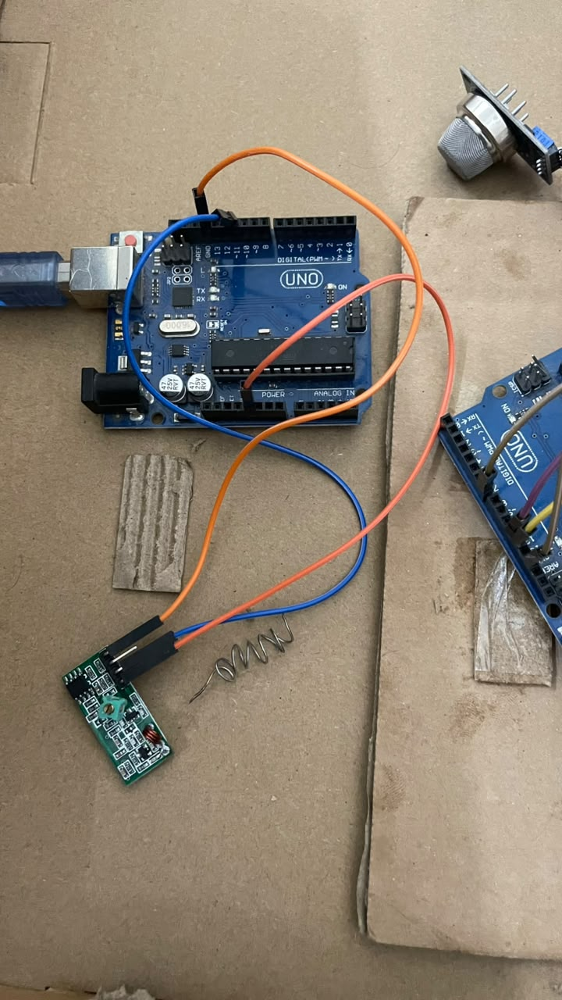
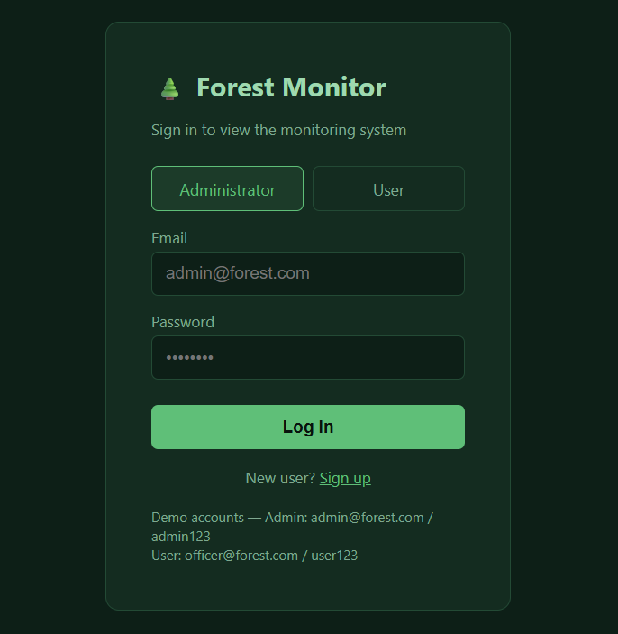

# 🌲 An IoT-Based Forest Network

An IoT-based forest monitoring system designed to monitor environmental conditions and support early forest fire-risk detection using wireless sensor nodes and a centralized monitoring dashboard.

## 📌 About the Project

This project was developed as our **Final Year Project (FYP)** at the **University of Engineering & Technology (UET), Taxila**.

The system uses IoT devices and Wireless Sensor Networks (WSN) to collect environmental data from distributed monitoring nodes. The collected data is transmitted to a central gateway and stored for visualization and monitoring.

Our goal is to explore a low-cost, practical approach to forest environmental monitoring and early fire-risk awareness.

## ✨ Key Features

- 🌡️ Temperature monitoring
- 💧 Humidity monitoring
- 🌫️ CO₂ monitoring
- 🌲 Forest environmental monitoring
- 🔥 Early fire-risk alerts
- 📡 Wireless communication between sensor nodes
- 📊 Centralized monitoring dashboard
- 🔔 Visual and audible alerts

## 🏗️ System Architecture

The system consists of environmental sensors, wireless sensor nodes, a central gateway, a database, a backend API, and a web-based dashboard.

**Data flow:**

Sensors → Wireless Sensor Nodes → Raspberry Pi Gateway → PostgreSQL Database → Flask REST API → Monitoring Dashboard

## 🛠️ Technologies Used

- **Programming:** Python, SQL
- **IoT & Hardware:** Raspberry Pi, environmental sensors, NRF wireless modules
- **Communication:** Wireless Sensor Networks (WSN), multi-hop communication
- **Backend:** Flask REST API
- **Database:** PostgreSQL
- **Frontend:** HTML, dashboard visualization

## 📸 Hardware Implementation

The hardware setup demonstrates the physical components used to implement the forest monitoring network.

## 📊 Monitoring Dashboard

The dashboard provides a visual representation of the environmental parameters collected by the monitoring system.

## 🎥 Project Demonstration

Watch the project demonstration:

[▶️ View Demonstration Video](WhatsApp Video 2026-07-14 at 4.35.23 PM.mp4)

## 🎯 Project Objectives

- Monitor environmental parameters using IoT-based sensor nodes.
- Establish wireless communication between distributed nodes and a central gateway.
- Store and visualize environmental data through a centralized system.
- Provide alerts to support early awareness of potential forest fire risks.
- Explore an affordable and scalable approach to forest monitoring.

## 👩‍💻 Project Team

This project was developed collaboratively as a Final Year Project at the University of Engineering & Technology (UET), Taxila.

- **Nimra Faryal**
- **Areeba Shahid**
- **Afnan Fatima**

**Supervisor:** Dr. Farrukh Zeeshan Khan

## 🚀 Future Improvements

- Deploy additional sensor nodes across larger monitoring areas.
- Improve communication reliability and energy efficiency.
- Incorporate predictive analytics for forest fire-risk assessment.
- Explore machine learning for environmental anomaly detection.

## 📄 Academic Project

Developed as a Final Year Project at the University of Engineering & Technology (UET), Taxila.

---

⭐ If you find this project interesting, feel free to explore the repository.
